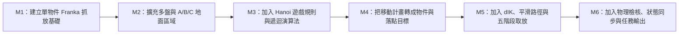
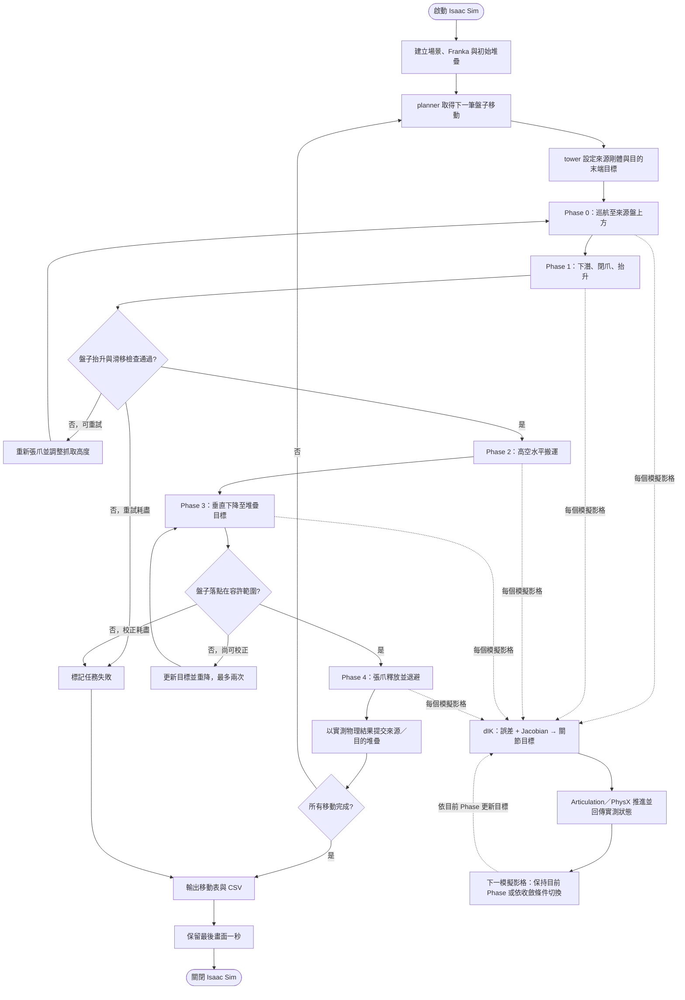

# 機械手臂河內塔虛實整合專案
## Franka Tower of Hanoi — Robotic Manipulation in NVIDIA Isaac Sim

---

## 🎯 核心學習目標

1. **場景建立**：由 `SimulationApp` 啟動 NVIDIA Isaac Sim，並在 USD Stage 動態建立多層河內塔場景（A/B/C 地面區域、彩色剛體盤子及物理材質）；場景沒有實體立柱，模擬播放由 Timeline 管理。
2. **河內塔演算法**：以遞迴分治法求得 $2^N - 1$ 步最優解，並透過符號層（內部堆疊狀態）與物理層（剛體位置）雙向同步，確保搬運順序合法無誤。
3. **手臂逆運動學**：實作差分逆運動學（dIK），以雅可比矩陣、阻尼最小平方法（Damped Least Squares）與零空間投影（Null-space Projection）驅動 Franka Emika Panda 7 軸手臂完成精確取放。

---

## 🏗️ 軟體架構與虛實整合

本專案直接以 `SimulationApp` 啟動 Isaac Sim，並透過 Timeline 與 `SimulationManager`
控制播放；沒有另外建立 `SimulationContext`、`World` 或 `InteractiveScene` 包裝層。
每一影格的控制與回饋順序如下：

| 階段 | 程式位置 | 輸入與輸出 |
|------|----------|------------|
| 啟動應用 | `main.py` | 建立 `SimulationApp`，啟用所需 Isaac Sim 擴充套件，啟動 Timeline |
| 建立虛擬場景 | `tower.py`、`pick_place.py` | 在 USD Stage 建立 Franka USD、地面、盤子剛體、A/B/C 地面區域標記與材質；場景沒有實體立柱 |
| 產生任務 | `planner.py`、`tower.py` | Hanoi 遞迴產生 `(盤子, 來源區, 目標區)`；`_stacks` 保存三個區域的符號堆疊狀態 |
| 計算末端命令 | `pick_place.py`、`franka.py` | 以世界座標位置及朝下四元數建立目標，dIK 將笛卡兒誤差轉成 7 軸關節位置目標 |
| 物理回饋與提交 | `tower.py` | 從 `RigidPrim` 和 `panda_hand` 讀取實際世界位姿；抓取、搬運、放置完成後才更新符號堆疊 |
| 輸出與關閉 | `main.py` | 將已完成移動輸出至終端與 CSV；需要錄影時擷取 RGB 並交由 OpenCV 編碼 |

### 功能實作歷程（M1–M6）

M1–M6 指專案功能的開發階段，不是實際搬盤的步驟編號。實作由單物件操作開始，逐層加入
場景、遊戲規則、機器人控制和物理結果檢核：



| 階段 | 實作內容 | 產出／檢核 | 主要程式 |
|------|----------|------------|----------|
| M1：抓放基礎 | 參考 NVIDIA Franka Pick-and-Place 示範的操作模式與 Isaac Sim API，建立單一物件、Franka 末端目標與夾爪控制 | 能以末端目標完成單次抓取與放置；來源界線見「專案來源與修改範圍」 | `franka.py`、`pick_place.py` |
| M2：擴充場景 | 將單物件場景改為多片不同尺寸的剛體盤，建立 A 起始區、B 暫存區、C 終點區的地面標記、盤子材質與初始堆疊；不建立實體立柱 | 初始盤子全在 A；地面區索引與 `_stacks` 對應 | `tower.py` |
| M3：加入遊戲規則與演算法 | 定義一次移一片、只移區域堆疊頂盤、大盤不可放在小盤上；以遞迴產生每筆 `(盤子索引, 來源區, 目標區)` | 檢查移動合法、終態全在 C、移動數為 $2^n-1$；規劃器可脫離 Isaac Sim 測試 | `planner.py`、`tests/test_planner.py` |
| M4：規劃連接場景 | 將移動計畫映射到實際盤子剛體與 A/B/C 目標區，依目的堆疊層數計算盤中心目標；已有盤子時讀取其實測位置 | 只選來源區頂盤；落點對準區域中心及預定堆疊高度 | `tower.py` |
| M5：加入手臂控制 | 以 smoothstep 產生末端路點，以 Franka Jacobian 和 dIK（預設 DLS）解 7 軸關節增量，再由五階段 FSM 執行接近、抓取、搬運、下降與釋放 | 每影格以新量測狀態重算命令；命令本身不代表剛體已到位 | `franka.py`、`pick_place.py` |
| M6：加入物理檢核與收尾 | 檢查抬升、水平漂移與落點；失敗時重抓或重降。完整抓放通過後才更新符號堆疊，並輸出 CSV／可選 MP4 | 失敗移動不提交為完成；所有移動完成或任務失敗後輸出結果 | `tower.py`、`main.py` |

M1–M6 是功能開發歷程；實際執行時，M3 產生的每筆移動都會走 M4–M6 的目標計算、取放與檢核。

**虛實同步邊界：** `_stacks` 是任務規劃用的離散狀態，不是物理引擎中的物件位置。
盤子的實際位置由 Isaac Sim 剛體模擬；控制器在抓取確認和放置校正時讀取剛體世界位姿，
只有完整取放 FSM 完成才提交下一筆 Hanoi 移動。若抓取或放置檢查失敗，任務會重試或停止，
不會把尚未完成的移動記入結果表。

## 🧩 專案來源與修改範圍

本專案以 NVIDIA Isaac Sim 官方提供的 Franka Panda 機器人 USD、Articulation／RigidPrim
等模擬 API，以及 Franka Pick-and-Place 示範所呈現的「設定末端目標、抓取物件、搬運並放置」
操作模式為基礎，加入河內塔任務規劃與模擬狀態協調。

**來源界線要說清楚：**`examples/original_franka/README.md` 記錄了上游 Franka 範例原始碼
在建立此工作區時並未提供。因此，本專案不能宣稱 `franka.py` 或 `pick_place.py` 是對該上游
原始檔逐行修改的版本；較準確的說法是參考其操作模式，並使用 NVIDIA API／資產實作本專案
的控制程式。兩個檔案保留 NVIDIA Copyright 與 Apache-2.0 SPDX 標頭，重新散布時仍須遵守
各檔案所附授權條款。

| 部分 | 來源／負責範圍 |
|------|----------------|
| Franka Panda USD、Isaac Sim、PhysX、Articulation、RigidPrim、場景與感測 API | NVIDIA 提供的模擬平台、機器人資產與 API |
| 末端差分 IK、阻尼策略、零空間偏好 | 本專案在 Isaac Sim 提供的 Jacobian 上實作；不是 NVIDIA 提供的 Hanoi 解法 |
| Hanoi 規則、遞迴移動表、A/B/C 堆疊模型 | 本專案 `planner.py` 與 `tower.py` |
| 取放狀態機、抓取確認、放置校正與重試 | 本專案 `pick_place.py` 與 `tower.py` |
| 任務輸出、CSV 與 MP4 錄影 | 本專案 `main.py`；pandas 負責表格，OpenCV 負責影片編碼 |

這不是只把示範中的來源／目標物件改名：本專案增加了離散 Hanoi 規劃層、物理剛體層之間的
狀態提交規則，以及對抓取與放置結果的實測檢查。

### NVIDIA 外部資源與 API

| 資源 | 本專案使用位置 | 用途／來源界線 |
|------|----------------|----------------|
| Franka Panda USD：`/Isaac/Robots/FrankaRobotics/FrankaPanda/franka.usd` | `franka.py` 的 `get_assets_root_path()` 與 `add_reference_to_stage()` | NVIDIA Isaac Sim 資產；選用 `AlternateFinger` 夾爪及 `Performance` 網格變體 |
| Isaac Sim `SimulationApp`、Timeline、`SimulationManager`、Extension Manager | `main.py` | NVIDIA Kit／Isaac Sim 應用生命週期、擴充管理與模擬狀態 API |
| `Cube`、`RigidPrim`、`GeomPrim`、`RigidBodyMaterial`、`GroundPlane`、`DomeLight` | `tower.py`、`pick_place.py` | NVIDIA Isaac Sim 實驗性物件、Prim、材質及場景 API；本專案用它們建立 USD 場景和物理剛體 |
| `set_camera_view`、Synthetic Data RGB Sensor | `main.py` | NVIDIA Isaac Sim 相機與視口影像擷取 API；只在錄影設定中使用 RGB 感測器 |
| NVIDIA Warp (`warp`) 與 Isaac Sim 四元數工具 | `franka.py` | Warp 陣列用於旋轉誤差計算；關節 Jacobian、dIK 分支及 Hanoi 規劃由本專案程式處理 |
| NVIDIA 官方文件 | [Isaac Sim Documentation](https://docs.isaacsim.omniverse.nvidia.com/latest/) | API／資產使用參考；實際載入的機器人資產路徑以 `franka.py` 中的 USD 路徑為準 |

`planner.py` 不匯入 Isaac Sim，也不依賴 NVIDIA 演算法；河內塔的遞迴移動序列是本專案的純 Python 實作。

---

## 🔢 演算法說明

### a. 規則、區域角色與遞迴規劃

盤子以大小命名：D1 最小，D2 次之，依此類推，Dn 最大。河內塔有三條規則：

1. 一次只移動一片盤子。
2. 每次只能取一個區域堆疊最上方的盤子。
3. 不可把較大的盤子放在較小的盤子上。

本專案把三個地面放置區固定命名為 A、B、C；場景只有區域標記，沒有實體立柱。Hanoi 遞迴中的
source、destination、spare 是三個抽象堆疊位置的角色，不代表場景裡有柱桿；遞迴呼叫時會
互換這些邏輯角色。

| 地面區 | 邏輯角色 | 程式索引 | 區域中心世界座標 (X, Y) 公尺 | 初始盤子 |
|------|------------|----------:|----------------------|----------|
| A | 起始區域 | 0 | (0.48, -0.28) | Dn 到 D1，由底至頂 |
| B | 暫存區域 | 1 | (0.48, 0.00) | 空 |
| C | 終點區域 | 2 | (0.48, +0.28) | 空 |

例如 3 盤時，三個區域的符號堆疊以「底到頂」表示為 A=[D3,D2,D1]、B=[]、C=[]；目標狀態是
A=[]、B=[]、C=[D3,D2,D1]。程式內部盤子索引從 0 開始：索引 0 是 D1，索引 i 是 D(i+1)，
所以 3 盤初始 `_stacks` 為 `[[2, 1, 0], [], []]`。這些索引對應 A/B/C 地面區域，不是立柱。

河內塔採用遞迴分治：把 n 片盤子由來源區移到目標區，先把上方 n-1 片移到暫存區，再移動最大盤，
最後把 n-1 片由暫存區移到目標區。此處的區域代表可形成堆疊的邏輯位置。遞迴展開如下：

```text
H(3, A, C, B)                  把三片由 A 搬到 C，B 暫存
|-- H(2, A, B, C)              先清空 D3 上方的小盤
|   |-- H(1, A, C, B)
|   |   |-- H(0, A, B, C)      空集合，不需移動
|   |   |-- move D1: A -> C
|   |   +-- H(0, B, C, A)      空集合，不需移動
|   |-- move D2: A -> B
|   +-- H(1, C, B, A)
|       |-- H(0, C, A, B)      空集合，不需移動
|       |-- move D1: C -> B
|       +-- H(0, A, B, C)      空集合，不需移動
|-- move D3: A -> C             最大盤露出後移動
+-- H(2, B, C, A)              把 D1、D2 移到 D3 上
    |-- H(1, B, A, C)
    |   |-- H(0, B, C, A)      空集合，不需移動
    |   |-- move D1: B -> A
    |   +-- H(0, C, A, B)      空集合，不需移動
    |-- move D2: B -> C
    +-- H(1, A, C, B)
        |-- H(0, A, B, C)      空集合，不需移動
        |-- move D1: A -> C
        +-- H(0, B, C, A)      空集合，不需移動
```

此圖對應 `plan_hanoi()` 內每一層的兩次遞迴呼叫，以及中間輸出一筆最大盤移動。子問題的區域
參數是邏輯角色，不是永遠固定的 A/B/C：第一個子問題把 spare 當目的地，第二個子問題則把 spare
當來源。函式輸出每筆 `(disk_index, source_peg, destination_peg)`；欄位名稱沿用舊識別字，
其中 peg index 實際代表 A/B/C 地面區域索引，不表示有實體柱桿。`tower.py` 再將它轉成
實際物件與位置目標。

### b. Hanoi 遞迴正確性與最少步數

正確性可用數學歸納法說明。基底 n=0 時沒有盤子，無須移動，合法完成。假設 n-1 片的子問題
能合法完成：第一次遞迴將較小的 n-1 片移至暫存區，讓第 n 片最大盤露出；此時最大盤可合法
移到空的目標區；第二次遞迴再把 n-1 片移到最大盤上。故 n 片問題也能合法完成。

令 T(n) 為 n 片盤子的最少移動數。任何解都必須在移動最大盤前先搬走上面 n-1 片，移動最大盤
後還必須再搬動這 n-1 片，因此

$$T(0)=0,\qquad T(n)=T(n-1)+1+T(n-1)=2T(n-1)+1.$$

兩邊加 1 得 T(n)+1=2(T(n-1)+1)。反覆代入可得 T(n)+1=2^n，故 T(n)=2^n-1。上述演算法
恰好使用這麼多步，達到所有合法解都必須滿足的下界，因此是最少步數解。若 n=3，移動數為
2^3-1=7；程式測試也會檢查每步合法性與最終堆疊狀態。

**四盤時第一個子問題的實際結果：**初始 A 由底到頂是 `D4,D3,D2,D1`。要移動 D4，先把
D1、D2、D3 依下表搬到 B；它們不是整疊搬動，而是由同一遞迴規則逐片完成：

| 次序 | 盤子移動 | 為何這一步可行 |
|---:|---|---|
| 1 | D1：A → B | D1 在最上方，可直接移動 |
| 2 | D2：A → C | D2 已露出；C 為空 |
| 3 | D1：B → C | D1 小於 D2，可放在 D2 上 |
| 4 | D3：A → B | D3 已露出；B 為空 |
| 5 | D1：C → A | D1 已露出；A 為空 |
| 6 | D2：C → B | D2 小於 D3，可放在 D3 上 |
| 7 | D1：A → B | D1 小於 D2，可放在 D2 上 |

七步後，B 由底到頂是 `D3,D2,D1`，A 只剩 D4，C 已清空。此時搬 D4：A → C，再將 B 上三片
盤子搬到 C。`planner.py` 只生成符號移動；`tower.py` 的 `_stacks` 保存已確認完成的離散狀態，
只有實際抓放完成後才更新，不會因為「已發出命令」就先假設物理移動成功。

---

### c. S 曲線平滑軌跡（三次 Hermite Smoothstep）

手臂各階段的位置命令採用三次 Hermite smoothstep。令 $t\in[0,1]$ 為正規化時間，並令 $s(t)=at^3+bt^2+ct+d$。施加 $s(0)=0$、$s(1)=1$ 及兩端斜率為零的四個邊界條件，可得：

$$s(t)=3t^2-2t^3,\qquad s(0)=0,\quad s(1)=1,\quad s'(0)=s'(1)=0.$$

若位置軌跡定義為 $\mathbf{p}(t)=\mathbf{p}_0+s(t)(\mathbf{p}_1-\mathbf{p}_0)$，則 $s(0)=0$、$s(1)=1$ 分別保證 $\mathbf{p}(0)=\mathbf{p}_0$ 與 $\mathbf{p}(1)=\mathbf{p}_1$；$s'(0)=s'(1)=0$ 使軌跡端點的參數速度為零。這些條件不代表實際關節速度、接觸力或碰撞安全已獲保證。此三次多項式的端點二階導數不為零，因此不能據此宣稱加速度連續。

相較於線性插值，smoothstep 讓笛卡兒位置命令以零端點速度進出；實際關節響應和接觸結果仍由 Isaac Sim 物理控制器決定。抓取底部另有到位收斂等待，並非全程連續運動。

---

### d. 差分逆運動學（dIK）

每一模擬影格，控制器讀取目前關節角 $\mathbf{q}$、末端位置 $\mathbf{p}$ 與單位四元數方向 $q$，並取得末端 Jacobian $\mathbf{J}(\mathbf{q})$。局部微分運動學以 $\Delta\mathbf{x}\approx\mathbf{J}(\mathbf{q})\Delta\mathbf{q}$ 描述小幅關節變化與末端任務空間變化的近似關係。令目標位姿記為 $\mathbf{x}_{d}=(\mathbf{p}_{d},q_{d})$；下標 $d$ 表示 desired（目標），不是乘法或額外變數。位置誤差為 $\mathbf{e}_{p}=\mathbf{p}_{d}-\mathbf{p}$。方向誤差由相對四元數 $q_{e}=q_{d}\otimes q^{-1}=(w_{e},\mathbf{v}_{e})$ 的向量部分建立，並選擇 $w_e\geq0$ 的等價表示以取較短旋轉路徑；這是小角度下與旋轉誤差成比例的局部表示，不是兩個四元數直接相減。位置模式使用 $\mathbf{e}_{p}$，姿態模式則串接 $\mathbf{e}=[\mathbf{e}_{p}^{\mathsf{T}},\mathbf{v}_{e}^{\mathsf{T}}]^{\mathsf{T}}$。控制器解出關節增量 $\Delta\mathbf{q}$，再令 $\mathbf{q}_{cmd}=\mathbf{q}+\Delta\mathbf{q}$。下一影格重新讀取物理狀態並重算增量，因此這是閉迴路、逐影格的差分 IK，而非一次產生完整關節軌跡。

以下為以 Moore–Penrose 偽逆表示的冗餘機械臂概念式：

$$\Delta\mathbf{q}=\mathbf{J}^{+}\mathbf{e}+(\mathbf{I}-\mathbf{J}^{+}\mathbf{J})\mathbf{z}.$$

其中 $\mathbf{e}$ 是前述局部任務空間誤差，位置模式為 3 維，姿態模式為 6 維。$\mathbf{J}^{+}\mathbf{e}$ 是主要任務的關節增量；$\mathbf{z}$ 表示次要關節姿態偏好，而 $\mathbf{I}-\mathbf{J}^{+}\mathbf{J}$ 將其投影至 Jacobian 的零空間，使次要目標在理想模型下不改變主要任務的一階末端速度。程式的主要任務預設使用自適應 DLS；零空間投影則使用精確 Moore–Penrose 偽逆，故上式是概念分解，不表示兩項都使用同一個阻尼偽逆。實際方法可由 `--ik-method` 選擇。

| 項目 | 說明 |
|------|------|
| **雅可比矩陣** $\mathbf{J}$ | 在目前構型附近將關節速度映射至末端線速度／角速度；此為局部線性化，不描述有限幅度運動的完整非線性關係 |
| **阻尼最小平方（DLS）** | 對 $\mathbf{J}=\mathbf{U}\mathbf{\Sigma}\mathbf{V}^{\mathsf{T}}$，以 $\sigma_i/(\sigma_i^2+\lambda^2)$ 取代 $1/\sigma_i$，降低小奇異值附近的增量放大；阻尼不等同關節限位或碰撞檢查 |
| **零空間投影** | $\mathbf{N}=\mathbf{I}-\mathbf{J}^{+}\mathbf{J}$；將次要姿態偏好投影至零空間。實作以精確偽逆構造 $\mathbf{N}$，並非使用 DLS 近似投影 |

`franka.py` 中的關節讀取、Jacobian、`set_dof_position_targets()`、`Articulation` 和
`RigidPrim` 來自 NVIDIA Isaac Sim；dIK 分支、阻尼調整及任務空間目標換算為本專案實作。

#### 從末端誤差到關節增量：二連桿數值推導

先用平面二連桿說明 Jacobian 如何由正向運動學求得。兩桿長度為 $L_1,L_2$，關節角為
$q_1,q_2$，末端位置為：

$$x=L_1\cos q_1+L_2\cos(q_1+q_2),\qquad
y=L_1\sin q_1+L_2\sin(q_1+q_2).$$

對關節角偏微分，得到 $\Delta\mathbf{x}\approx\mathbf{J}\Delta\mathbf{q}$：

$$\mathbf{J}=\begin{bmatrix}
-L_1\sin q_1-L_2\sin(q_1+q_2) & -L_2\sin(q_1+q_2)\\
L_1\cos q_1+L_2\cos(q_1+q_2) & L_2\cos(q_1+q_2)
\end{bmatrix}.$$

令 $L_1=L_2=1$ m、$q_1=0$、$q_2=90^\circ$，目前末端在 $(1,1)$ m，且
$\mathbf{J}=\begin{bmatrix}-1&-1\\1&0\end{bmatrix}$。若目標為 $(1.1,0.9)$ m，
位置誤差 $\mathbf{e}=(0.1,-0.1)^T$ m；解 $\mathbf{J}\Delta\mathbf{q}=\mathbf{e}$ 得
$\Delta q_1=-0.1$ rad、$\Delta q_2=0$。把新角度代回原非線性公式，末端約在
$(1.0948,0.8952)$ m，還有約 7 mm 誤差。這個殘差正是「Jacobian 只在目前構型附近線性
近似」的結果，所以控制器要重新量測並再解一次，而不是假設一次求解就完全到位。

此數值例僅用來示範微分與線性化，不是 Franka 的實際關節資料。真實 Panda 的正向運動學、
末端 Jacobian 及關節狀態來自 Isaac Sim 所載入的 USD／Articulation；本專案用該 Jacobian
計算每影格增量。

### e. 機械手臂運動方式與控制流程

控制採用「上層給末端路徑點、下層解關節增量、模擬器回傳實際狀態」的閉迴路方式：

1. `planner.py` 提供下一個離散移動 `(disk_index, source, destination)`。`tower.py` 由
    `_stacks` 找出來源區頂盤與目的區預定層，並使用剛體的實際世界座標修正目標高度。
2. `FrankaPickPlace` 將任務目標拆成五個操作階段；移動階段以 smoothstep 產生末端位置路點，
    抓取和釋放階段則控制夾爪開合。路點是笛卡兒空間的命令，不是直接修改盤子的座標。
3. 每個模擬影格，`Franka.set_end_effector_pose()` 讀取實際關節角與末端位姿，取得當前
    Franka Jacobian，將位置／姿態誤差解成關節增量，再設定 Articulation 關節目標。
4. Isaac Sim 的關節控制器與 PhysX 推進機器人和剛體；下一影格重新讀取實測結果。任務層以
    盤子抬升量、水平漂移與落點誤差驗證抓取／放置，必要時重試或校正。
5. 一筆完整抓放成功後，`tower.py` 才把盤子索引由來源 `_stacks` 移到目的 `_stacks`，再
    進入下一筆 Hanoi 移動。規劃狀態不會超前於物理結果。

五個 Phase 的操作內容、時序與檢查條件集中列於下方 FSM 表格；這裡著重說明每個階段如何
透過末端路點、dIK 與物理回授形成閉迴路。



> 每搬移一片盤子，狀態機依序完整執行 Phase 0 → 1 → 2 → 3 → 4，完成後才進入下一步。

| Phase | 名稱 | 說明 |
|:-----:|------|------|
| **0** | 橫向巡航至方塊正上方 | 手臂保持安全巡航高度（`_safe_transit_z`），以 S 曲線水平移動至目標方塊正上方，避免碰撞目的區已堆疊的盤子 |
| **1** | V 形抓取＋退避 | **張爪下潛**至抓取目標 → 在底部張爪等待末端位置收斂（最長等待受限）→ **閉爪保持** → 提升至安全高度；抬升後再驗證盤子是否被夾起，失敗最多重試 3 次 |
| **2** | 水平搬運 | 夾持方塊以 S 曲線水平飛行至目標區上方；途中持續監測方塊相對夾爪滑移量 |
| **3** | 垂直緩降（10 mm 嚴格收斂） | 以精確 Z 軸下降至放置位置，注入 −6 mm 貼地微壓補償重力下垂；若對準誤差 > 容許值，可退回此階段最多修正 2 次 |
| **4** | 開爪釋放＋退避 | 張爪釋放方塊後垂直退避至安全高度，消除放置後的夾爪擠壓回彈與方塊擺動 |

---

## 🛠️ 環境需求

| 項目 | 規格 |
|------|------|
| 模擬平台 | **NVIDIA Isaac Sim 6.0** |
| Python | **3.10+**（由 Isaac Sim 內建環境提供） |
| GPU | **NVIDIA GPU**（需支援 RTX 光追，建議 RTX 3070 以上） |
| 作業系統 | Ubuntu 22.04 LTS（官方支援） |

---

## 🚀 快速啟動

```bash
# 3 層河內塔（7 步，適合初學驗證）
./run.sh --disks 3

# 5 層河內塔（31 步，觀察避障走廊動態調整）
./run.sh --disks 5

# 8 層河內塔（255 步，長時間耐久測試）
./run.sh --disks 8

# 10 層河內塔（1023 步，最高挑戰）
./run.sh --disks 10

# 選擇性以 20 Hz 輸出末端世界位置與四元數方向（預設 false）
./run.sh --disks 3 --log-end-effector-pose true

# 降低視窗與 MP4 錄影解析度（預設 960x540；也可選 640x360 或 1280x720）
./run.sh --disks 3 --resolution 640x360

# 顯示 Isaac Sim 側邊與底部面板（預設隱藏）
./run.sh --disks 3 --show-panels
```

> **支援層數範圍**：`--disks` 參數可接受 2 至 10（對應 3 至 1023 步）。
>
> 任務完成或中止時，pandas 移動表會印在終端並存成 CSV，與 MP4 使用相同檔名主體。
> 例如影片 `recordings/hanoi_3disks_時間戳.mp4` 對應表格
> `recordings/hanoi_3disks_時間戳.csv`。預設不輸出末端姿態；使用
> `--log-end-effector-pose true` 才會開啟 20 Hz 診斷列印。
> `--resolution` 會同時設定模擬視窗與錄影影格大小；解析度越低，影片檔案通常越小。
> 預設會在場景建立前隱藏 Stage、Property、Content、Console、Timeline 與 Render Settings 面板，任務結束後保留 1 秒再自動關閉 Isaac Sim；使用 `--show-panels` 可保留面板。

---

## 📁 資料夾結構

```
hanoi_tower/
├── main.py                     # 模擬主程式入口（參數解析、視窗、相機視角、自動 MP4 錄影）
├── run.sh                      # 執行腳本（自動定位本機 Isaac Sim python.sh）
├── README.md                   # 專案說明文件（本文件）
├── .gitignore                  # Git 忽略清單（排除大型影片、虛擬環境與快取）
├── examples/
│   └── original_franka/        # 上游 Franka 範例來源說明（原始碼未附）
│       └── README.md
├── hanoi_tower/                # 核心控制套件
│   ├── __init__.py             # 套件模組初始化
│   ├── planner.py              # 純演算法模組：河內塔分治求解、S 曲線、高度計算
│   ├── franka.py               # Franka 機器人介面：雅可比 dIK、阻尼自適應、零空間投影
│   ├── pick_place.py           # 5 階段取放有限狀態機（FSM）與 S 曲線軌跡插值
│   └── tower.py                # 河內塔場景建置、方塊階梯寬度、避障巡航走廊與貼地校正
├── tests/                      # 單元測試套件
│   └── test_planner.py         # 測試河內塔步數最優性、合法性、平滑步進函數
└── recordings/                 # 錄影影片儲存目錄
    ├── .gitkeep                # 保留目錄結構
    └── hanoi_<盤數>disks_<時間戳>.mp4/.csv  # 執行時產生的同名影片與移動表
```

---

## ❓ 常見問題 Q&A

**Q1：執行 `./run.sh` 時出現「找不到 Isaac Sim」錯誤？**
> `run.sh` 會先檢查 `~/isaacsim`，再搜尋 `~/.local/share/ov/pkg/isaac-sim*`。若安裝於其他位置，執行前設定 `ISAAC_SIM_PATH=/你的/Isaac-Sim-安裝目錄` 即可，不必修改腳本。

**Q2：單元測試可以在沒有 GPU 的環境下執行嗎？**
> 可以。`tests/test_planner.py` 僅測試純 Python 演算法模組（河內塔步驟生成、S 曲線插值、高度計算），不依賴 Isaac Sim 或 GPU，可在任何具備 Python 3.10+ 的環境中以 `python3 -m unittest discover -s tests -v` 秒級通過。

**Q3：增加盤子數量時，模擬速度變慢的原因？**
> 步驟數以 $2^N - 1$ 指數成長（10 層需執行 1,023 次完整 Pick-Place 循環），每個循環包含 5 個 Phase，總幀數極大。建議搭配 `--headless` 無圖形介面模式以提升模擬速度，或縮短每 Phase 的步進時間（調整 `events_dt` 參數）。

---

## 📚 NVIDIA 外部資源與程式來源

- **NVIDIA Isaac Sim 6.0：** 執行平台。`SimulationApp`、Timeline、Extension Manager、`SimulationManager`、USD Stage 及實驗性 `Cube`、`RigidPrim`、`GeomPrim`、`RigidBodyMaterial` 等 API 由 Isaac Sim 提供。
- **NVIDIA Franka Panda USD：** `franka.py` 經 `get_assets_root_path()` 載入 `/Isaac/Robots/FrankaRobotics/FrankaPanda/franka.usd`，選用 `AlternateFinger` 夾爪及 `Performance` 網格變體。機器人模型是 NVIDIA 資產，不是本專案自製。
- **NVIDIA Franka 抓取／放置示範脈絡：** 本專案參考官方示範的單物件抓放操作模式及 Isaac Sim API；上游範例原始碼未包含在此工作區，因此不宣稱 `franka.py`、`pick_place.py` 是其原始檔的直接修改版。兩個檔案保留 NVIDIA Copyright 與 Apache-2.0 SPDX 標頭；重散布時請遵守檔案所附授權條款。本專案自行加入 Hanoi 遞迴任務、多盤 A/B/C 地面區域場景、符號堆疊同步、抬升檢查及放置校正。
- **NVIDIA Warp 與 Isaac Sim 四元數工具：** `franka.py` 用於四元數乘法及共軛運算；Jacobian 誤差解算流程與 Hanoi 遞迴是本專案程式，不應誤標為 Warp 或 NVIDIA Hanoi 演算法。
- **NVIDIA Synthetic Data：** 錄影模式下擷取視口 RGB；OpenCV 負責 MP4 編碼，pandas 負責移動表格與 CSV，兩者為第三方 Python 套件。
- **參考文件：** [NVIDIA Isaac Sim Documentation](https://docs.isaacsim.omniverse.nvidia.com/latest/)。外部 USD 資產實際路徑以 `franka.py` 的引用字串為準。

**本專案自行實作：** `planner.py` 的 Hanoi 遞迴與數值輔助函式；`tower.py` 的 A/B/C 區域堆疊模型、物理位姿校正和失敗重試；`pick_place.py` 的本專案五階段時序與位置插值；`franka.py` 的 dIK 求解控制流程；以及 `main.py` 的 pandas 移動紀錄。NVIDIA 提供模擬器、機器人 USD、底層物理／Articulation 能力與相關 API，不是這些 Hanoi 任務演算法的作者。
